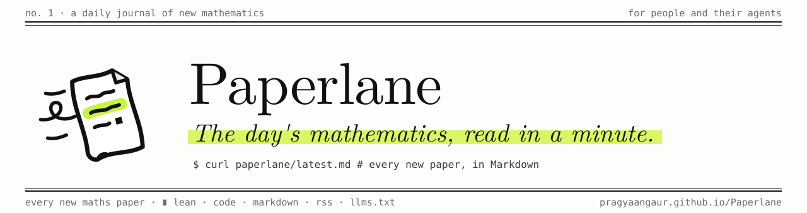
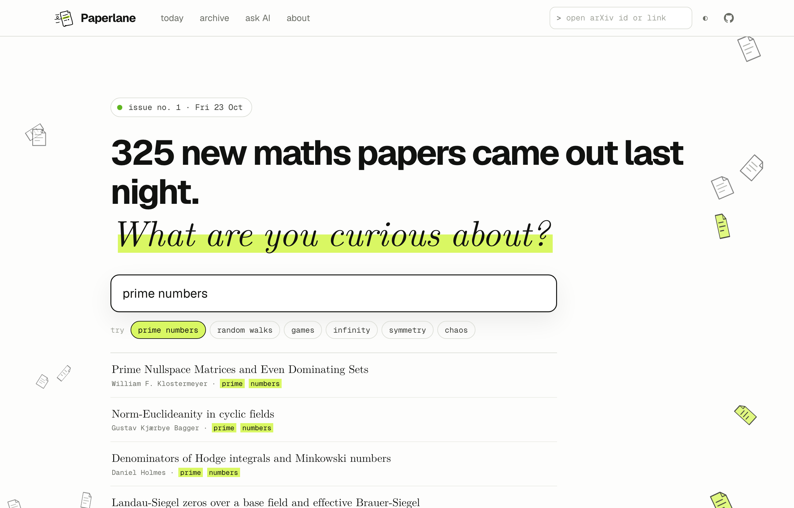
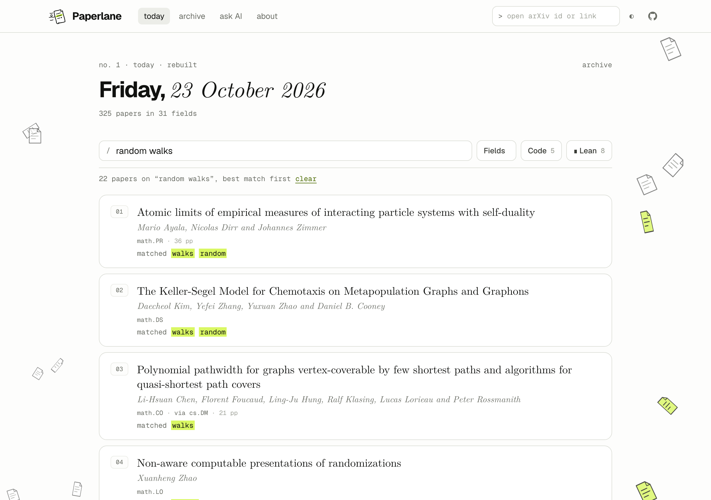
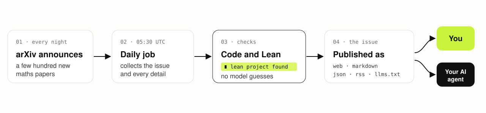
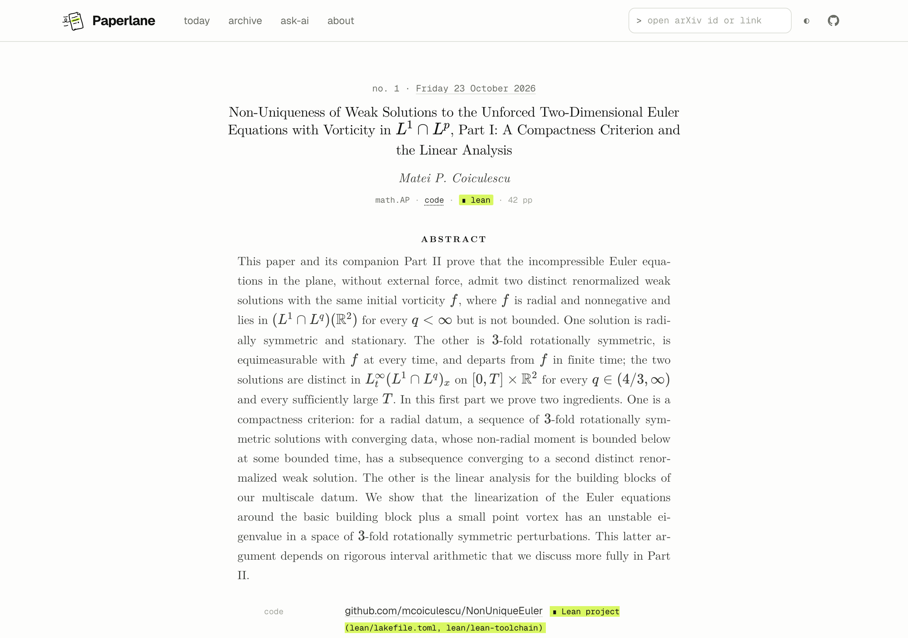
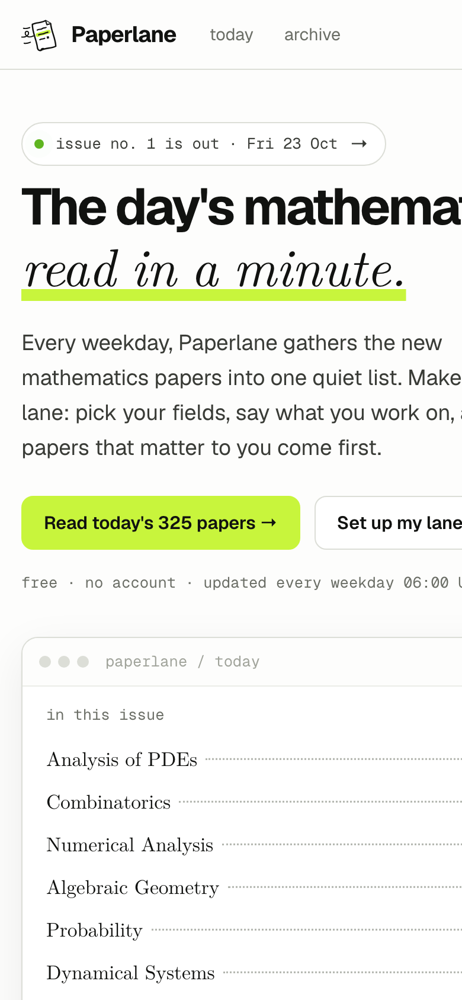

<p align="center">
  
</p>

<p align="center">
  <a href="https://pragyaangaur.github.io/Paperlane/"></a>
  <a href="https://github.com/pragyaangaur/Paperlane/actions/workflows/daily.yml"></a>
  
  
</p>

<p align="center">
  <a href="https://pragyaangaur.github.io/Paperlane/"><b>Read today's issue</b></a>
  &nbsp;·&nbsp;
  <a href="https://pragyaangaur.github.io/Paperlane/ask.html">Ask your AI</a>
  &nbsp;·&nbsp;
  <a href="https://pragyaangaur.github.io/Paperlane/llms.txt">llms.txt</a>
  &nbsp;·&nbsp;
  <a href="https://pragyaangaur.github.io/Paperlane/about.html">About</a>
</p>

Every weekday a few hundred new mathematics papers come out. One night of them is about 57,000 words of abstracts, the length of a short novel, and almost nobody sees it happen. Paperlane turns each night into one short issue that you can skim in a minute and your AI assistant can read in seconds.

Type anything you are curious about and the matching papers from last night appear as you type. If you do research, type what you work on and the closest papers come first. If you would rather not read papers at all, paste one prompt into the AI you already pay for, and it tells you what mathematicians found last night in plain words. Paperlane is free and needs no account.

<p align="center">
  
</p>

## Start in ten seconds

1. Open [Paperlane](https://pragyaangaur.github.io/Paperlane/).
2. Type a topic, such as `random walks`, or press one of the suggestions under the box.
3. Open any paper that catches your eye, or press **see all** to get the whole issue ranked for what you typed.

<p align="center">
  
</p>

## What you can do

- **Search the night.** One box ranks every paper against what you type, best match first, and shows the words that matched. It uses BM25, the formula behind most search engines, and counts words in a title twice. British and American spellings match each other. The search runs in your browser, so nothing you type is sent anywhere, and Paperlane never ranks a paper by who wrote it.
- **Skim by field.** With no search, papers sit under their main field, three at a time until you ask for the rest. Fields you pick move to the top next time.
- **Keep code and proofs.** The **Code** and **Lean** buttons keep only papers that link to code or to a Lean formalisation.
- **Open any paper.** Paste an arXiv link or id into the box in the header. Papers from any issue open on their own page, and older papers are looked up for you.
- **Take the Markdown.** Every paper has a Markdown version one click away, ready for a chat window or your notes.

## If you are not a mathematician

Paste this into ChatGPT, Claude, Gemini or any assistant that can open web pages:

> Read https://pragyaangaur.github.io/Paperlane/latest-titles.md, the list of new maths papers from the latest Paperlane issue. Pick the two results a curious person with no maths degree would find most surprising, read their abstracts in https://pragyaangaur.github.io/Paperlane/latest.md, and explain each one in plain words with an everyday example.

## Get a briefing every morning

Many assistants can now run scheduled routines. Open [ask AI in routine mode](https://pragyaangaur.github.io/Paperlane/ask.html?mode=routine), pick a time and your timezone, type what you work on, and Paperlane writes a prompt that sets up a routine for every weekday. Each run reads the new issue and sends you the three papers worth your time. On days with no new issue it says so in one line. The page shows when the new issue arrives in your own timezone, so you can pick a time after it.

## What Paperlane does for your AI

- **A night of maths is a short novel.** Paperlane reads it once and hands your assistant an index of about 7,500 words, so the answer is fast and cheap.
- **Some answers need real work.** Checking every linked repository for a Lean project takes real requests, and compiling the proofs (coming next) takes real computing time. Paperlane does this once, for everyone.
- **Nothing is made up.** Every tag is a plain check that anyone can repeat, so an assistant reading Paperlane cannot be fooled into claiming a proof that does not exist.
- **It remembers.** Every issue stays in the archive, so you can look back across weeks and see when a paper was revised.

## For your AI agent

Open [**ask AI**](https://pragyaangaur.github.io/Paperlane/ask.html) to build a prompt and copy it, or write your own:

> Read https://pragyaangaur.github.io/Paperlane/latest-titles.md, Paperlane's index of today's new maths papers. My interests are extremal graph theory and polyominoes. Pick the candidates that fit, read their abstracts in https://pragyaangaur.github.io/Paperlane/latest.md, and tell me which three papers I should read and why.

Tools can fetch the same files directly:

```bash
curl -s https://pragyaangaur.github.io/Paperlane/latest-titles.md | head
```

| File | What it holds |
| --- | --- |
| [`llms.txt`](https://pragyaangaur.github.io/Paperlane/llms.txt) | A guide to every file below, written for language models |
| [`latest-titles.md`](https://pragyaangaur.github.io/Paperlane/latest-titles.md) | One line per paper with its id, fields, tags, title and authors |
| [`latest.md`](https://pragyaangaur.github.io/Paperlane/latest.md) | The whole issue with abstracts |
| [`latest.json`](https://pragyaangaur.github.io/Paperlane/latest.json) | The whole issue with every field |
| `latest/<field>.md` | One field of the issue, for example [`latest/math.CO.md`](https://pragyaangaur.github.io/Paperlane/latest/math.CO.md) |
| `p/<arXiv id>.md` | One paper, for example [`p/2610.30655.md`](https://pragyaangaur.github.io/Paperlane/p/2610.30655.md) |
| [`feed.xml`](https://pragyaangaur.github.io/Paperlane/feed.xml) | RSS for your feed reader |

## How it works

<p align="center">
  
</p>

A scheduled job collects the night's announcement and looks up the details of each paper. It checks every linked GitHub repository for a Lean project and then publishes the issue in every format at once. Every tag comes from a simple check that anyone can repeat, and no language model decides anything about a paper.

## What the tags mean

| Tag | Meaning |
| --- | --- |
| `∎ lean` | A linked GitHub repository contains a Lean project (`lean-toolchain` or a `lakefile`) |
| `□ lean` | The paper says it is formalised in Lean, but no repository was found |
| `code` | The abstract or comments link to code on GitHub, GitLab or a similar host |
| `via cs.CC` | A paper from another subject that its authors also listed under mathematics |
| `v2` | A revised version of an older paper |

<table>
  <tr>
    <td width="70%"></td>
    <td width="30%"></td>
  </tr>
</table>

## Privacy

Paperlane counts visits with [GoatCounter](https://www.goatcounter.com), which sets no cookies and stores no personal data. It also counts a few anonymous events, such as a prompt being copied, to learn which features people use. Your fields and interests stay in your browser.

## What comes next

- A check that linked Lean projects actually compile, so the Lean tag can mean a verified proof.
- An optional email digest of the papers on your topics.
- A direct connection for AI assistants, so an agent can ask Paperlane for today's papers in your fields.

## Feedback

Paperlane is new and changes quickly. If something feels wrong or you want a feature, please [open an issue](https://github.com/pragyaangaur/Paperlane/issues).

Paper details come from arXiv. Thank you to arXiv for use of its open access interoperability.
