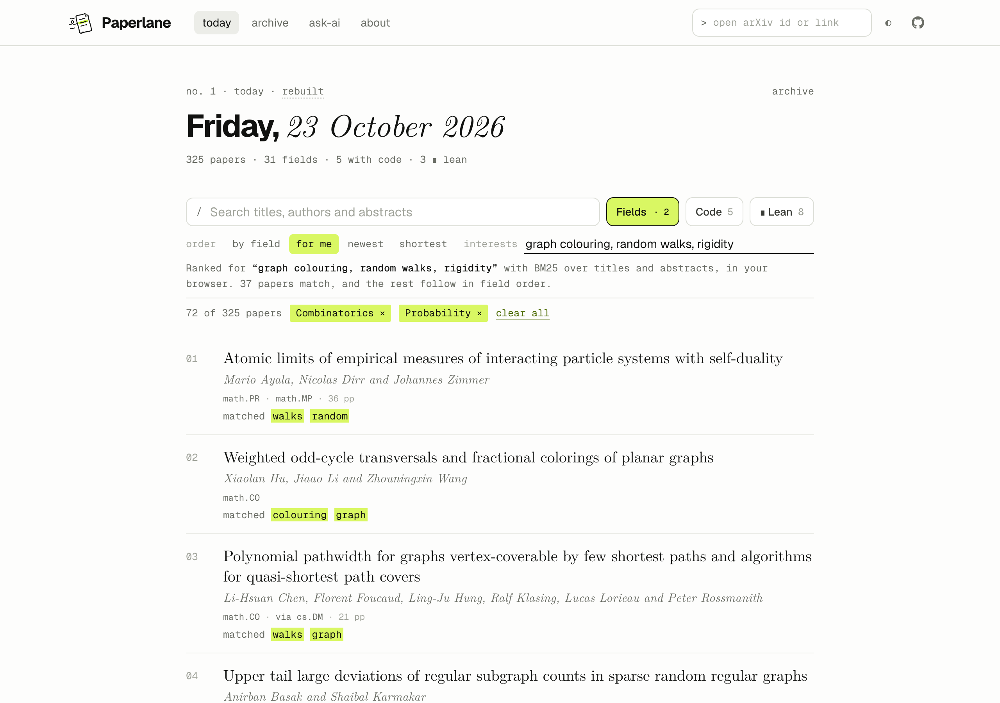

  

  <a href="https://pragyaangaur.github.io/Paperlane/"><b>Read today's issue</b></a>
  &nbsp;·&nbsp;
  <a href="https://pragyaangaur.github.io/Paperlane/#lane">Set up your lane</a>
  &nbsp;·&nbsp;
  <a href="https://pragyaangaur.github.io/Paperlane/about.html">How it works</a>

A few hundred new mathematics papers appear every weekday. Paperlane sets each day as one quiet issue, with every paper in the typeface of a LaTeX preprint, and it highlights the ones that matter to you the way you would mark a printout. You pick your fields and say what you work on, and the papers that matter to you come first. Every paper is also plain Markdown, so your own AI assistant can read the whole issue for you. It is free and needs no account.

  

## Make it your lane

1. **Pick your fields.** Tick Combinatorics, Probability or any other field. Paperlane remembers them on your device.
2. **Say what you work on.** Type a few phrases such as "graph colouring, random walks".
3. **Read.** Your papers rise to the top, and under each one Paperlane highlights the words that matched.

  

## How the order works

There are four orders, and the page always says which one is in use.

- **By field** groups papers under their main field, largest field first, with your own fields on top. Inside a field, papers keep the order in which they were submitted.
- **For me** ranks papers against your interests with BM25, the classic search ranking formula, over titles and abstracts. Titles count twice, exact phrases get a bonus, and British and American spellings match each other. This runs in your browser, and your interests are never sent anywhere.
- **Newest** puts the latest submissions first.
- **Shortest** sorts by the page count that the authors give.

Paperlane never ranks a paper by its authors or their reputation.

## Every paper, set like a first page

Click a paper to read its abstract in place, or open its own page. Each page carries the same tags, a PDF link and a Markdown copy that you can paste into a chat.

<table>
  <tr>
    <td width="70%"></td>
    <td width="30%"></td>
  </tr>
</table>

## What the tags mean

| Tag | Meaning |
| --- | --- |
| `∎ lean` | A linked GitHub repository contains a Lean project (`lean-toolchain` or a `lakefile`) |
| `□ lean` | The paper says it is formalised in Lean, but no repository was found |
| `code` | The abstract or comments link to code on GitHub, GitLab or a similar host |
| `via cs.CC` | A paper from another subject that its authors also listed under mathematics |
| `v2` | A revised version of an older paper |

Each tag comes from a simple check that anyone can repeat. A check that Lean proofs actually compile is planned.

## For agents

Press **ask-ai** on the site for a ready prompt, or point an assistant at [`llms.txt`](https://pragyaangaur.github.io/Paperlane/llms.txt). Every issue is published as Markdown, JSON and RSS, and every paper has its own Markdown file.

## When it updates

A new issue appears every Monday to Friday at about 06:00 UTC, and every earlier issue stays in the [archive](https://pragyaangaur.github.io/Paperlane/archive.html).

## Feedback

Paperlane is new. If something feels wrong or you want a feature, please [open an issue](https://github.com/pragyaangaur/Paperlane/issues).

Paper details come from arXiv. Thank you to arXiv for use of its open access interoperability.
