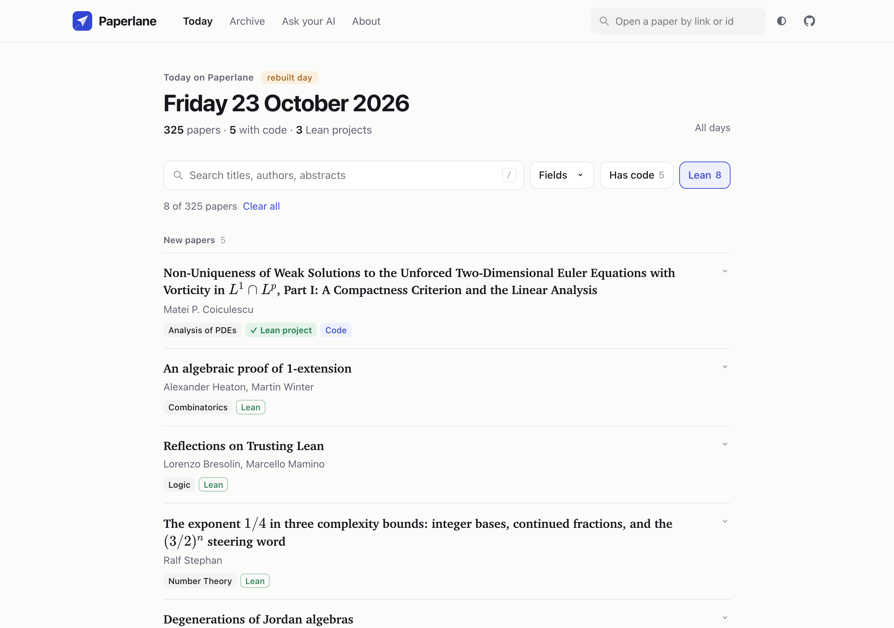
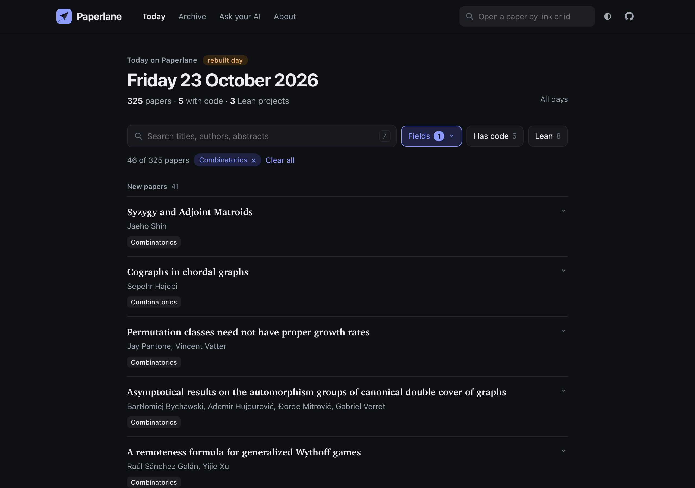

  

  <a href="https://pragyaangaur.github.io/Paperlane/"><b>Open Paperlane →</b></a>
  &nbsp;·&nbsp;
  <a href="https://pragyaangaur.github.io/Paperlane/today.html">Today's papers</a>
  &nbsp;·&nbsp;
  <a href="https://pragyaangaur.github.io/Paperlane/about.html">About</a>

A few hundred new mathematics papers appear every weekday, and the usual listing is hard to skim. Paperlane puts each day on one calm page. You pick your fields, glance at titles and open only the papers you care about. Every paper is also plain Markdown, so your own AI assistant can read the whole day for you. It is free and needs no account.

  

## How it works

1. **Pick your fields.** Choose Combinatorics, Probability or any other field on the home page. Paperlane remembers your choice on your device.
2. **Skim the list.** Each paper shows only its title, authors and a few tags. Click a paper to read its abstract.
3. **Go deeper.** Open the PDF, copy the paper's Markdown, or copy a link to share.

  

## What you get

- **Filters that stay out of the way.** One search box and three buttons sit above the list: Fields, Has code and Lean. Every filtered view has its own link, so you can bookmark it or send it to a colleague.
- **Code and Lean, spotted for you.** Papers that link to code get a **Code** tag. If the linked repository holds a Lean project, the paper gets a green **✓ Lean project** tag.
- **Any paper from a link.** Paste an arXiv link or id into the search box at the top of any page, and Paperlane opens that paper with its abstract and a Markdown copy.
- **Markdown for every paper.** The Markdown button shows a clean copy right under the paper, ready for a chat window or your notes.
- **Light and dark.** Paperlane follows your system theme, and the switch in the header lets you pick one yourself.

<table>
  <tr>
    <td width="68%"></td>
    <td width="32%"></td>
  </tr>
</table>

## Let your AI pick your papers

Click **Ask your AI** on the site and type what you work on. Paperlane writes a prompt for you to paste into any assistant that can open web pages:

> Read https://pragyaangaur.github.io/Paperlane/latest-titles.md, Paperlane's index of today's new maths papers. My interests are extremal graph theory and polyominoes. Pick the candidates that fit, read their abstracts, and tell me which three papers I should read and why.

Paperlane never ranks papers or scores their authors. Your assistant ranks the day against your own interests. The [About page](https://pragyaangaur.github.io/Paperlane/about.html#agents) lists every file that agents can read, from a one-line-per-paper index to a full JSON feed.

## What the tags mean

| Tag | Meaning |
| --- | --- |
| **Code** | The abstract or comments link to a code host such as GitHub or GitLab |
| **✓ Lean project** | A linked GitHub repository contains a `lean-toolchain` or `lakefile` file |
| **Lean** | The paper says it is formalised in Lean, but no Lean repository was found |
| **v2, v3 …** | The paper is a new version of an older one |

Each tag comes from a simple check that anyone can repeat. The Lean project tag shows that a Lean project exists in the repository, and a check that the proof compiles is planned.

## When it updates

A new day appears every Monday to Friday at about 06:00 UTC. Every earlier day stays in the [archive](https://pragyaangaur.github.io/Paperlane/archive.html).

## Feedback

Paperlane is new. If something feels wrong or you want a feature, please [open an issue](https://github.com/pragyaangaur/Paperlane/issues).

Paper details come from arXiv. Thank you to arXiv for use of its open access interoperability.
